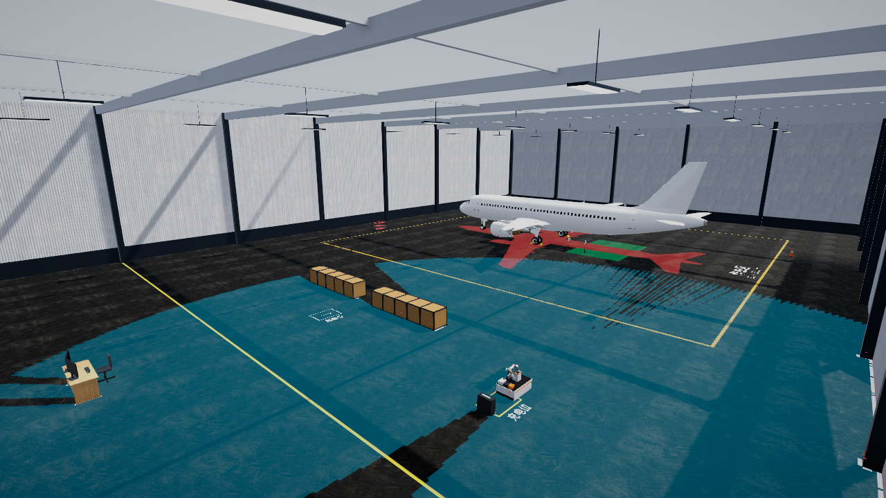
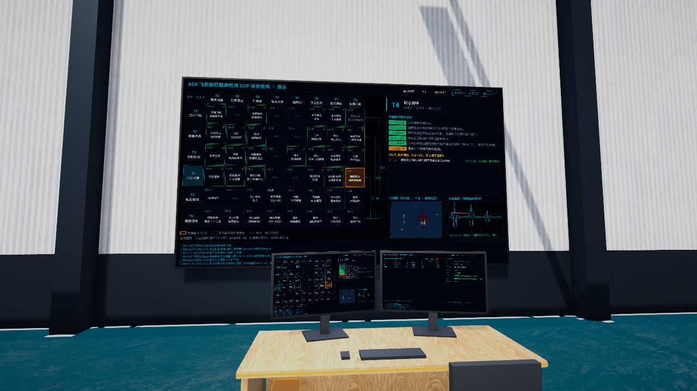
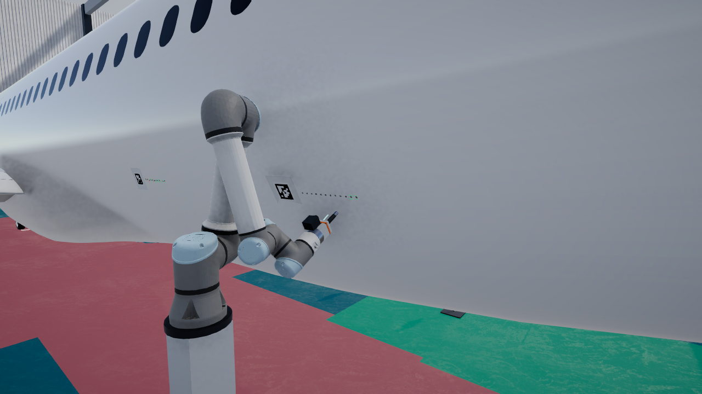
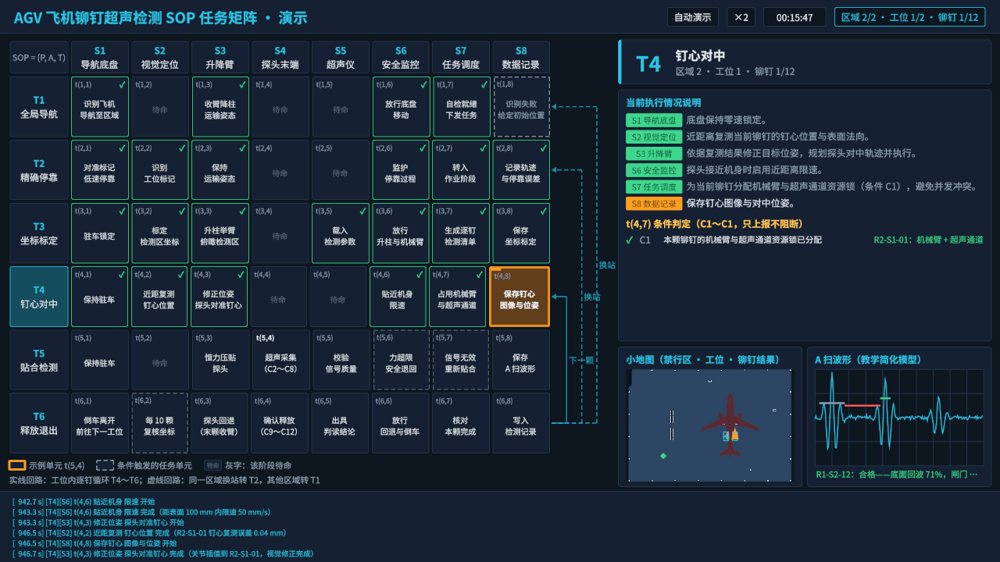
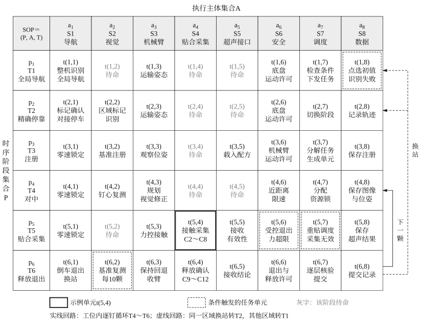

# RivetSim — AGV 飞机铆钉超声检测示教仿真

> A Unity 6 teaching simulation: an AGV with a UR5e arm maps a hangar, navigates to an A320 model, and ultrasonically inspects 48 rivets following an SOP task matrix, with a live demo console UI.

RivetSim 是一个基于 **Unity 6（URP）** 的教学演示仿真。场景是一个 64 × 44 m 的机库：一台带升降柱和 UR5e 机械臂的 AGV 从充电位出发，先巡游建图，再按 **SOP 任务矩阵（6 阶段 × 8 主体）** 依次到达 A320 模型机（1:1.5）两侧的 4 个检测工位，对 48 颗铆钉逐颗做超声检测（A 扫判读），最后返回充电位并导出检测结果 CSV。演示台电脑屏幕和大屏实时显示任务矩阵、执行说明、小地图、A 扫波形和日志。

当前版本：**v1.1**（2026-10-19 验收）。



| 演示台屏幕 | 末端特写 | 小地图 |
|---|---|---|
|  |  |  |

---

## 目录

- [功能概览](#功能概览)
- [快速开始](#快速开始)
- [操作说明](#操作说明)
- [项目结构](#项目结构)
- [代码架构](#代码架构)
- [SOP 任务矩阵](#sop-任务矩阵)
- [配置参数](#配置参数)
- [编辑器菜单（生成 / 验证 / 构建）](#编辑器菜单生成--验证--构建)
- [二次开发指南](#二次开发指南)
- [AI 协作开发环境（可选）](#ai-协作开发环境可选)
- [测试](#测试)
- [文档索引](#文档索引)
- [已知限制与后续规划](#已知限制与后续规划)
- [第三方资产与许可](#第三方资产与许可)

---

## 功能概览

| 模块 | 内容 |
|---|---|
| 场景 | 机库分为作业区（A320 模型机 + 检测区铆钉）、移动区（障碍物、窄通道、充电位）和演示区（演示台双显示器 + 大屏） |
| AGV | 差速底盘运动学、升降柱、安全联锁（零速锁定 / 升降柱最低位 / 机械臂运输姿态） |
| 建图与导航 | 2D 激光 → 占据栅格（教学简化模型，使用真值位姿）、虚拟禁行区、代价地图、8 邻域 A* + 平滑、纯追踪、标记对接停靠、倒车退出 |
| 机械臂 | UR5e 运动学（来自官方 ROS 2 描述）、阻尼最小二乘逆解、命名姿态、法向逼近、连杆到机身间隙检查 |
| 超声检测 | 虚拟弹簧接触力、合成 A 扫波形、闸门判读（合格 / 疑似 / 缺陷 / 无效）、腕部相机注册与对中；以上均为教学简化模型 |
| 任务流程 | 从 JSON 读取 SOP 任务矩阵，按阶段并行执行，支持逐钉循环、换站、条件触发单元；随机故障注入后自动恢复 |
| 演示界面 | UI Toolkit 演示屏（任务矩阵、阶段卡、执行说明、小地图、A 扫、日志）、检测结果与设备状态页、HUD、4 个机位 + 自动机位（防遮挡） |
| 交互 | 自动 / 分步 / 遥控三种模式，倍速 ×0.5～×8（带帧率保护），矩阵全屏，Esc 确认退出 |

一次完整流程（种子 42，3 次随机故障）的仿真用时约 1375～1476 s。×2 倍速下实际约 12 分钟，×8 下约 3 分钟。

---

## 快速开始

### 环境要求

| 项 | 版本 |
|---|---|
| Unity Editor | **6000.0.71f1**（Unity 6.0 LTS）。建议使用完全相同的版本，其他 6000.0.x 理论上可用，但未测试 |
| 渲染管线 | URP 17.0.4 |
| 主要包 | Input System 1.19（只启用新输入系统）、AI Navigation 2.0.11、glTFast 6.20.0、Newtonsoft Json 3.2.1、Test Framework 1.6.0 |
| 平台 | Windows 10 / 11 x64（已验证）。项目没有平台特定代码，但其他平台未测试 |

> `Packages/manifest.json` 里的 `com.unity.pipeline`（0.8.0-exp.1）是让 Unity CLI / AI 助手控制编辑器的桥接包，运行仿真本身不需要它。配置方法见 [AI 协作开发环境（可选）](#ai-协作开发环境可选)；不用 AI 协作、并且这个包解析失败时，可以把它从 manifest 中删掉。

### 方式 A：在编辑器中运行（推荐，可二次开发）

```bash
git clone https://github.com/1940553872/AGV_Aircraft.git
```

1. 用 Unity Hub 添加并打开克隆下来的文件夹，编辑器版本选 6000.0.71f1。第一次打开要导入资源，需要几分钟。
2. 打开场景 `Assets/_Project/Scenes/Main_TeachingHall.unity`。
3. 点击 **Play**。程序默认以“自动演示”模式运行完整流程：建图 → T1～T6 矩阵流程 → 返回充电位。

仓库已包含生成好的场景、预制体、材质和全部第三方资产（`Assets/ThirdParty/`），克隆后不需要额外下载。

### 方式 B：构建 Windows 独立程序

1. 在编辑器中执行菜单 **RivetSim → Build → Windows v1.1**，输出到 `Builds/v1.1/AGV_Aircraft.exe`。`Builds/` 不入库。
2. 双击 `AGV_Aircraft.exe` 运行，默认全屏窗口模式。也可以用 Unity 标准启动参数改成窗口模式：

```bash
./AGV_Aircraft.exe -screen-fullscreen 0 -screen-width 1920 -screen-height 1080
```

3. 退出：按 **Esc** 弹出确认框，再按 **Enter**；或点 HUD 右上角的“Esc 退出”按钮。
4. **拷贝到其他电脑**：只拷 exe 是不行的，必须拷贝**整个输出文件夹**：`AGV_Aircraft.exe`、`AGV_Aircraft_Data/`、`UnityPlayer.dll`、`MonoBleedingEdge/`、`D3D12/`、`UnityCrashHandler64.exe`（约 220 MB，建议打成 zip）。对方不需要安装 Unity，要求是 Windows 10 / 11 64 位、支持 DirectX 11 的显卡。`AGV_Aircraft_BurstDebugInformation_DoNotShip/`、`PerfLogs/`、`build_summary.txt` 不用拷。

**帧率复测**：加参数 `-perfRun` 启动时，程序先以 ×2 运行 180 s，再切到 ×8 跑到流程结束，然后自动退出。结果写在 exe 同目录的 `PerfLogs/summary.txt`（帧率、倍速保护、尖峰）和 `frames.csv`。参考结果见 [Docs/Reports/Build_v1.1.md](Docs/Reports/Build_v1.1.md)（Ultra 9 275HX + RTX 5060 Laptop：×8 平均 398 FPS）。

### 输出文件

| 内容 | 位置 |
|---|---|
| 检测结果 CSV（每颗铆钉的位置、真值缺陷、判读结论、接触力、耦合质量、时间戳） | `%USERPROFILE%\AppData\LocalLow\DefaultCompany\AGV_Aircraft\Reports\inspection_*.csv`（`Application.persistentDataPath/Reports`） |
| 运行日志 | 编辑器在 Console 中；独立程序在同一目录的 `Player.log` |

---

## 操作说明

### HUD（屏幕顶部）

| 区域 | 功能 |
|---|---|
| 模式 | **自动**（连续运行，可调倍速）/ **分步**（每个阶段开始前暂停，点“下一步”继续）/ **遥控**（流程结束后可用，WASD 驾驶） |
| 倍速 | 下拉框 ×0.5 / ×1 / ×2 / ×4 / ×8。×8 时如果实际帧率低于 20 FPS 并持续 3 s，会自动降到 ×4 并提示 |
| 暂停 / 下一步 | 暂停或继续仿真；分步模式下进入下一阶段 |
| 机位 | 1 总览、2 跟随、3 特写、4 演示台、0 自动（按阶段切换，检测时自动避开车体和机械臂的遮挡） |
| 视图 | V 可视化（栅格 / 禁行区 / 激光 / 路径）、Tab 矩阵全屏、B 大屏切换“任务矩阵 / 检测结果与设备状态” |
| 退出 | 右上角“Esc 退出”：弹出确认框，确认框打开期间仿真暂停 |

### 快捷键

| 键 | 功能 |
|---|---|
| `1`～`4` / `0` | 预设机位 / 自动机位 |
| `Tab` | 演示屏矩阵全屏（全屏时可点单元格查看说明卡） |
| `B` | 大屏视图切换（全屏时切换全屏页） |
| `P` | 暂停 / 继续 |
| `N` | 下一步（分步模式） |
| `V` | 显示 / 隐藏可视化 |
| `空格` | 急停 |
| `W A S D` | 遥控 AGV（遥控模式） |
| `Esc` | 打开 / 取消退出确认框 |
| `Enter` | 确认框打开时确认退出 |

### 故障演示

故障不需要手动触发。每轮流程开始时，`RandomFaultScheduler` 按种子随机安排 3 类故障（识别失败、力超限、采集无效），每类至多一次。故障发生时 HUD 显示 3 s 提示“系统检测到异常：…，正在自动处理”，对应的条件单元在矩阵上点亮，流程随后自动恢复。触发识别失败时会弹出 t(1,8) 小地图，可以点选 AGV 的初始位置；自动模式下由模拟操作员倒计时后给出。

---

## 项目结构

```
AGV_Aircraft/
├─ Assets/
│  ├─ _Project/                 # 本项目全部内容
│  │  ├─ Art/                   #   Materials / Models / Textures
│  │  ├─ Config/                #   CFG_*.asset 参数配置（ScriptableObject）
│  │  │  └─ TaskMatrix/         #   SOP_TaskMatrix_v1.json（流程唯一数据源）
│  │  ├─ Prefabs/               #   Aircraft / DemoStation / Environment / Robot / Vis（多由生成器产出）
│  │  ├─ Scenes/
│  │  │  ├─ Main_TeachingHall.unity   # 主场景（构建入口）
│  │  │  └─ Sandbox/            #   Sandbox_Robot（导航 / 升降 / 检测子系统）、Sandbox_UI（假数据驱动的界面沙盒）
│  │  ├─ Scripts/               #   见下文“代码架构”
│  │  └─ UI/                    #   UXML / USS / PanelSettings / 字体资源
│  ├─ ThirdParty/               # 外部资产原件（A320、UR5e、AprilTag、Noto Sans SC、Poly Haven 贴图），不改原件
│  └─ _Archive/                 # 早期模板内容（只归档，不使用）
├─ Docs/                        # 设计、决策、进度、验证报告、截图（见“文档索引”）
├─ Packages/                    # manifest.json
├─ ProjectSettings/
├─ _Downloads/                  # 第三方资产原始下载（不在 Assets 内，Unity 不导入；由导入器复制到 ThirdParty）
├─ Builds/                      # 构建输出（不入库）
└─ CLAUDE.md                    # AI 协作（Claude Code）规则，也概括了本项目的编码约定
```

### 脚本目录（`Assets/_Project/Scripts/`）

| 目录 | 内容 |
|---|---|
| `Core/Clock` | `SimClock`：仿真时间、倍速、暂停 |
| `Core/Events` | `EventBus`：强类型发布 / 订阅（事件为 `readonly struct : ISimEvent`） |
| `Core/Logging` | `SimLog`：分类日志，同时输出到 Console 和演示屏 |
| `Core/Config` | 各 `CFG_*` 的配置类型（`SimSettings`、`AgvConfig`、`ArmConfig`…） |
| `Core/TaskMatrix` | 任务矩阵数据模型、JSON 读取与校验 |
| `Core/Mission` | 流程事件（`PhaseEnteredEvent`、`CellStateChangedEvent`…）、黑板等 |
| `Core/Diagnostics` | `GcProbe` 等诊断工具 |
| `Simulation/World` | 区域 / 工位 / 铆钉登记、AprilTag 标记、充电位 |
| `Simulation/Robot` | 底盘、升降柱、安全监视、UR5e 运动学 / 逆解 / 控制、接触模型、电量与通讯（教学简化模型） |
| `Simulation/Navigation` | 激光、占据栅格、建图、禁行区、代价地图、A*、路径跟踪、对接 |
| `Simulation/Inspection` | A 扫合成、闸门判读、腕部视觉、单钉检测服务、检测记录 |
| `Simulation/Mission` | `MissionOrchestrator`、执行器注册、`ConditionBus`、随机故障调度 |
| `Presentation/App` | 入口 `AppBootstrap`、`RobotRuntime`、`MissionRoutine`、`DemoUiHub`、`DemoModeController`、`SpeedGuard`、`AppExit`、`BuildPerfProbe` |
| `Presentation/UI` | `DemoConsoleView`、`HudView`、`InspectionStatusView`、矩阵单元 / 回路箭头 / 小地图 / A 扫自定义元素 |
| `Presentation/CameraControl` | `CameraRig`（预设机位、自动机位、防遮挡） |
| `Presentation/Input` | `DemoHotkeys`、`AgvTeleopInput`、`VisualizationToggleInput` |
| `Presentation/Visualization` | 栅格 / 禁行区 / 点云 / 路径 / 铆钉结果环 / 视场锥等叠加显示 |
| `Editor/Generators` | 场景、预制体、材质、UI 资产生成器（幂等） |
| `Editor/Importers` | 第三方资产导入 |
| `Editor/Tools` | 验证工具（`M8VerifyRunner` 等）、截图工具、构建菜单 `BuildV11` |
| `Tests/EditMode` | EditMode 单元测试 |

---

## 代码架构

四个程序集，依赖只能单向：

```
RivetSim.Core  ←  RivetSim.Simulation  ←  RivetSim.Presentation
      ↑                  ↑                        ↑
      └──────── RivetSim.Editor（仅编辑器）────────┘
RivetSim.Tests.EditMode → Core, Simulation
```

- **Core**：不依赖场景的基础设施，包括配置类型、任务矩阵、事件总线、时钟、日志。
- **Simulation**：机器人、导航、检测、任务编排与世界对象，**不得引用 Presentation**。
- **Presentation**：UI、可视化、相机、输入、启动入口。只读取状态、订阅事件、调用公开方法。

### 运行时主流程

1. `_System/AppBootstrap`（场景唯一入口）加载配置，在充电位生成 AGV，并由 `RobotRuntime` 组装时钟、事件总线、安全监视、地图、导航、机械臂和检测服务。
2. `MissionRoutine`：建图（`MappingRoutine`）→ `MissionOrchestrator.RunAsync`（按 JSON 推进 T1～T6、逐钉循环与换站）→ 返回充电位 → 导出 CSV。
3. `DemoUiHub` 把 HUD 和快捷键的请求转给 `DemoModeController`、`CameraRig`、演示屏；界面只订阅事件（`CellStateChangedEvent`、`PhaseEnteredEvent`、`ConditionCheckedEvent`、`LoopTakenEvent`、`RivetInspectedEvent`）和只读接口。
4. 仿真按**固定子步**推进：倍速只改变每帧的子步数，单步动力学与 ×1 完全相同。业务代码一律使用 `SimClock` 的时间，不读 `Time.deltaTime`。

### 编码约定（摘要）

- 参数放进 ScriptableObject 配置，不写魔法数字；物理量带单位后缀（`M`、`Mm`、`Mps`、`Deg`、`S`、`N`），内部计算用 SI 单位。
- 任务流程用 `Awaitable` + `CancellationToken` 编写，不用协程。
- 日志统一用 `SimLog`；不用 `GameObject.Find` / `SendMessage`；`FindObjectsByType` 只在启动入口使用。
- UI 使用 UI Toolkit（UXML + USS），中文字体为 Noto Sans SC。
- 一个文件一个公开类型，公开类型写中文 XML 注释；命名空间与路径一致（如 `Scripts/Simulation/Navigation/GridAStar.cs` → `RivetSim.Simulation.Navigation`）。
- 命名前缀：预制体 `PF_`、材质 `M_`、贴图 `T_`、配置 `CFG_`、UXML/USS `UI_`。
- 场景、预制体、材质由**编辑器生成器**产出，不手工编辑 `.unity` / `.prefab` / `.asset` 的 YAML。

完整设计见 [Docs/Architecture.md](Docs/Architecture.md)，架构决策见 [Docs/DECISIONS.md](Docs/DECISIONS.md)。

---

## SOP 任务矩阵



- 数据源：`Assets/_Project/Config/TaskMatrix/SOP_TaskMatrix_v1.json`。**单元文字、类型、回路一律从 JSON 读取，代码里不写死流程。**
- 6 个阶段：T1 全局导航、T2 精确停靠、T3 注册、T4 对中、T5 贴合采集、T6 释放退出。
- 8 个主体：S1 导航、S2 视觉、S3 机械臂、S4 贴合采集、S5 超声接口、S6 安全、S7 调度、S8 数据。
- 单元类型：`active`（实线）、`standby`（灰字待命）、`conditional`（虚线，条件触发）。
- 回路：实线“下一颗”（T6 → T4，工位内逐钉）；虚线“换站”（同一区域换站转 T2，换区域转 T1）。
- 条件 C1～C12 在 t(4,7)、t(5,4)、t(6,4) 按 `conditionRefs` 判定。
- 每个单元的 `executor` 键名映射到 `ExecutorRegistry` 中的执行器实现。
- 矩阵显示文字为优化版（`label` / `name`），参考图原文保留在 `labelOriginal` / `nameOriginal`，详见 [Docs/Reference/SOP_TaskMatrix_v1.md](Docs/Reference/SOP_TaskMatrix_v1.md)。
- 在编辑器中可用菜单 **RivetSim → Debug → Print Task Matrix** 打印矩阵。

---

## 配置参数

所有参数都在 `Assets/_Project/Config/` 的 ScriptableObject 中，选中资产后在 Inspector 里修改即可。

| 资产 | 主要内容 |
|---|---|
| `CFG_SimSettings` | 随机种子（默认 42）、倍速选项与默认倍速、默认演示模式、流程入口、随机故障开关 / 概率 / 种子偏移、倍速保护阈值 |
| `CFG_SceneLayout` | 大厅尺寸、三区矩形、障碍物、充电位、巡游建图路线、演示台尺寸 |
| `CFG_Agv` | 车体尺寸、轮距、速度 / 加速度限制、雷达与机械臂安装位姿、电量 / 通讯教学模型参数 |
| `CFG_Arm` | UR5e 运动学来源、关节限位与速度、命名姿态、逆解参数、检测动作、连杆间隙、腕部相机噪声 |
| `CFG_Navigation` | 栅格分辨率、代价、纯追踪参数、到点容差、对接参数、停靠合格容差 |
| `CFG_Inspection` | 区域 / 工位 / 铆钉排布、蒙皮厚度、声速、接触力与弹簧刚度、A 扫与缺陷模型、闸门参数 |
| `CFG_UiTheme` | 配色、字号、小地图颜色、各阶段的自动机位 |
| `CFG_RenderLook` | 光照、曝光、Bloom 等观感参数（改完需要重跑 Generate Main Teaching Hall Scene） |

硬件与场地参数多为**预估值**（见 Architecture.md §6.1），没有按实际选型标定。

---

## 编辑器菜单（生成 / 验证 / 构建）

所有工具都在菜单 **RivetSim** 下：

| 菜单 | 用途 |
|---|---|
| `Setup/Run All M0 Setup` | 创建目录、默认配置、Layers 与时间设置（新工程初始化用；已有工程不需要） |
| `Setup/Create Default Configs` | 只补缺失的配置资产，不覆盖已有资产 |
| `Import/Third Party Assets` | 把 `_Downloads/` 中的原始资产复制到 `Assets/ThirdParty/`（跳过内容相同的文件） |
| `Generate/All` | 全量重新生成场景与资产（幂等），完成后主场景约 987 个物体 |
| `Generate/Main Teaching Hall Scene`、`AGV`、`Aircraft A320`、`Arm UR5e`、`Rivet Zones`、`Demo Station`、`Demo UI Assets`… | 单项生成 |
| `Generate/Sandbox Scenes` | 生成 Sandbox_Robot / Sandbox_UI |
| `Config/Apply M8 Values` | 把 v1.1 参数写入已有配置资产 |
| `Verify/Run M8` | 快进完整流程 + 随机故障 + ×8 窗口 + 强制降速 + 间隙 + 布局 + 遮挡 + 截图，约 2 分钟，结果写入 `Docs/Reports/M8.md` |
| `Verify/Run Mission (Fast)`、`Run Demo UI`、`Run M7 Demo` | 早期里程碑的验证工具，仍可用 |
| `Debug/Print Task Matrix`、`Check Station Reachability`、`Check Stow Envelope`、`Capture *` | 调试打印、可达性检查与截图 |
| `Build/Windows v1.1` | 构建 Windows 64 位独立程序到 `Builds/v1.1/` |

---

## 二次开发指南

| 想做的事 | 改哪里 |
|---|---|
| 改流程（单元、回路、条件） | 只改 `SOP_TaskMatrix_v1.json`；需要新的动作时，在 `Simulation/Mission` 新增 `ITaskExecutor` 实现并在 `ExecutorRegistry` 注册键名 |
| 调整速度、尺寸、检测参数 | 改对应的 `CFG_*.asset`，并在其 `notes` 字段注明来源 |
| 改场景布局 / 外观 | 改 `CFG_SceneLayout` / `CFG_RenderLook` 或对应生成器（`Editor/Generators`），然后执行 `Generate/*`，不要手工编辑场景 YAML |
| 换模型（飞机 / 机械臂） | 原件放进 `Assets/ThirdParty/`（不改原件），调整放在 `_Project/Prefabs` 的 Prefab Variant 中，并在 `Docs/ThirdPartyAssets.md` 登记许可 |
| 改界面 | `Assets/_Project/UI/UI_*.uxml / .uss` + `Presentation/UI`；界面只订阅事件与只读接口，不直接驱动仿真 |
| 新增故障 / 条件 | `ConditionBus` + `RandomFaultScheduler`（`Simulation/Mission`），并在 JSON 的 `conditions` 中补充文字 |
| 接入真实算法 | 导航（`NavigationService`）、检测（`RivetInspectionService`）、视觉（`WristVision`）都是独立服务，可以替换实现，保持公开方法和事件不变即可 |

开发流程建议：

1. 改代码后等编译完成，确认 Console 里 0 错误、没有新增警告。
2. 跑 EditMode 测试，再跑 `Verify/Run M8` 做一次完整流程回归，对照 `Docs/Reports/M8.md`。
3. 超出当前范围的想法记到 `Docs/PROGRESS.md` 的“待办”。

本项目是在 AI 协作（Claude Code）下按里程碑 M0～M8 开发的。`CLAUDE.md`、`Docs/HANDOFF.md`、`Docs/PromptTemplates.md` 记录了协作规则、会话交接和提示词模板。继续用 AI 协作开发时，新会话先读 `Docs/HANDOFF.md`。

---

## AI 协作开发环境（可选）

本项目的场景、预制体和验证流程，都是由 Claude Code 通过 **Unity CLI** 控制正在运行的 Unity 编辑器完成的，不手工编辑场景文件。想用同样的方式继续开发，按下面 5 步配置。只在编辑器里手动开发的话，可以跳过本节。

### 1. 安装 Unity CLI

在 Windows PowerShell 中执行（目前是 beta 通道）：

```powershell
$env:UNITY_CLI_CHANNEL='beta'; irm https://public-cdn.cloud.unity3d.com/hub/prod/cli/install.ps1 | iex
```

装好后**新开一个终端**，再验证（本项目开发时用的是 `1.0.0-beta.13`）：

```bash
unity --version
```

如果新终端里仍然找不到 `unity`，可以用完整路径 `%LOCALAPPDATA%\Unity\bin\unity.exe` 调用。

### 2. 在 Unity 工程中安装 Pipeline 包（`com.unity.pipeline`）

这个包运行在编辑器内，CLI 通过它向编辑器发送命令。它来自 Unity 官方 UPM 注册表，要求 Unity 6.0 及以上。

- **本项目**：`Packages/manifest.json` 里已经声明了这个包，用 Unity 打开工程时会自动解析，不需要额外操作。
- **其他工程，或需要重新安装 / 升级时**：

```bash
unity pipeline install --project-path "D:/path/to/AGV_Aircraft"
```

想安装指定版本，加参数 `--package-version 0.8.0-exp.1`；想强制改写成最新版，加 `--force`。

### 3. 确认编辑器已连上

用 Unity 打开工程，然后执行：

```bash
unity status
```

列表里出现本工程、状态为 `ready`，就表示连接成功。再执行 `unity command`，会列出编辑器提供的全部命令。可以试着用一条命令跑一次完整流程验证：

```bash
unity command --timeout 300 menu "RivetSim/Verify/Run M8"
```

### 4. 在 Claude Code 中安装 Unity 插件

Unity 官方插件提供了 Unity CLI、UI Toolkit、URP 等技能。在 Claude Code 会话中输入以下两条斜杠命令：

```text
/plugin marketplace add Unity-Technologies/unity-agent-plugin
/plugin install unity@unity-agent-plugin
```

也可以在终端里用 `claude` 命令安装，安装后要重启 Claude Code，或在会话中执行 `/reload-plugins` 才生效：

```bash
claude plugin marketplace add Unity-Technologies/unity-agent-plugin
```

```bash
claude plugin install unity@unity-agent-plugin
```

装好后，在 Claude Code 里输入 `/unity:` 就能看到这些技能，`/plugin` 列表里也会显示 `unity` 已启用。

### 5. （可选）把编辑器注册为 MCP 服务器

如果希望 Claude 把编辑器命令当作 MCP 工具直接调用，而不是通过终端执行 `unity command`，可以执行：

```bash
unity mcp configure claude-code --project-path "D:/path/to/AGV_Aircraft"
```

用 `--dry-run` 可以先预览会写入的配置，`unity mcp configure --list` 可以查看所有支持的客户端及其配置文件路径。不配 MCP 也完全可以：Claude Code 直接在终端里调用 `unity command` 就能工作，本项目一直是这样用的。

### 协作约定与常见问题

- Claude Code 每次会话都会自动读取 [CLAUDE.md](CLAUDE.md)（强制规则：程序集依赖、编码规范、只通过编辑器生成资产等）。新会话开场先读 [Docs/HANDOFF.md](Docs/HANDOFF.md)，再按 [Docs/PromptTemplates.md](Docs/PromptTemplates.md) 中的模板布置任务。
- **`unity status` 连不上**：多半是工程有编译错误，编辑器进了安全模式（Safe Mode），Pipeline 包没有加载。先执行 `unity pipeline list` 确认，修好编译错误后重启 Unity。
- **编辑器失去焦点后 Play 不推进**：在 Play 模式中执行 `unity command eval --code 'UnityEngine.Application.runInBackground = true;'`。这条命令只在本次运行中生效，不改项目设置。
- **PowerShell 会剥掉 `eval --code` 里的双引号**：在 Git Bash 中调用，或把 C# 写进文件，再用 `unity command eval_file --file <路径>` 执行。
- **`eval` 在主线程上限时 5 s**：长任务请改用编辑器菜单 + 报告文件（例如 `Verify/Run M8` 把结果写进 `Docs/Reports/M8.md`）。

---

## 测试

- 打开 **Window → General → Test Runner → EditMode → Run All**，共 125 个测试（v1.1）。
- 覆盖：任务矩阵读取与校验、A*、差速运动学、UR5e 逆解收敛、A 扫合成与闸门判读、接触力、运输姿态外廓、`MissionOrchestrator`（假执行器跑通含条件单元的流程）、随机故障调度等。
- 完整流程验证：`RivetSim/Verify/Run M8`，结果写入 `Docs/Reports/M8.md`。

---

## 文档索引

| 文件 | 内容 |
|---|---|
| [Docs/Architecture.md](Docs/Architecture.md) | v1 架构、模块、SOP 执行语义、场景布局、默认参数、界面规范 |
| [Docs/DECISIONS.md](Docs/DECISIONS.md) | 架构决策记录（ADR） |
| [Docs/PROGRESS.md](Docs/PROGRESS.md) | 里程碑验收记录、已知限制、v2 建议、待办 |
| [Docs/HANDOFF.md](Docs/HANDOFF.md) | 现有接口与关键约定速查（≤ 80 行） |
| [Docs/Reports/](Docs/Reports/) | 各里程碑验证报告（M5～M8）与独立程序复测报告 Build_v1.1 |
| [Docs/Reference/](Docs/Reference/) | SOP 任务矩阵参考图与说明、A320 层级、可达性分析 |
| [Docs/ThirdPartyAssets.md](Docs/ThirdPartyAssets.md) | 第三方资产来源与许可登记 |
| [Docs/AssetGuide.md](Docs/AssetGuide.md) | 资产下载与放置说明 |
| [Docs/PromptTemplates.md](Docs/PromptTemplates.md) | 各里程碑的 AI 提示词模板 |

---

## 已知限制与后续规划

**v1 的简化与限制**

- 建图、A 扫、接触力、视觉、电量与通讯都是**教学简化模型**。导航使用真值位姿，没有里程计漂移和扫描匹配。
- t(1,8) 操作员给出的初值只写入黑板和日志，不参与定位；点选只给位置，不给朝向。
- 条件 C4 / C6 / C8 偶有未满足（583 次检查中约 4 次），尚未逐颗定位原因。C1～C12 是固定的示例文字与阈值，只上报，不阻断流程。
- 机械臂只做间隙检查，不做避碰规划（末端连杆到机身最小 148 mm）。
- 独立程序中，阶段切换处偶发 40～46 ms 的单帧尖峰；独立程序的矩阵流程用时比编辑器快进短约 100 s，原因待查（见 Build_v1.1 报告）。

**后续版本（规划，未实现）**

- v2：初值参与定位、条件逐颗定位、参数按实际选型替换、演示屏更高分辨率；硬件方案对比（麦克纳姆 / 四轮转向、稳定裕度、能耗、通讯链路）；领域本体驱动的任务矩阵生成与应急调度。
- v3：里程计 + 扫描匹配 SLAM、Hybrid A* / DWA、机械臂避碰规划、更真实的 A 扫模型、ROS 2 桥接。

---

## 第三方资产与许可

| 资产 | 来源 | 许可 |
|---|---|---|
| Airbus A320-200 模型 | [Sketchfab / Dlourine](https://sketchfab.com/3d-models/airbus-a320-200-02470bf974e645f78f5d9385a333e9e0) | CC BY 4.0（已缩放为 1:1.5 并简化，程序内显示致谢角标） |
| UR5e 网格与运动学参数 | [Universal_Robots_ROS2_Description](https://github.com/UniversalRobots/Universal_Robots_ROS2_Description) | BSD-3-Clause |
| AprilTag tag36h11 | [AprilRobotics/apriltag-imgs](https://github.com/AprilRobotics/apriltag-imgs) | BSD 2-Clause |
| Noto Sans SC 字体 | [Google Fonts](https://fonts.google.com/noto/specimen/Noto+Sans+SC) | SIL OFL 1.1 |
| 地面 / 金属 / 墙面 / 木纹贴图 | [Poly Haven](https://polyhaven.com/) | CC0 |

> “Airbus A320-200” by Dlourine (https://sketchfab.com/fDlruosne), licensed under CC BY 4.0, scaled and simplified for this simulation.

各资产的版本、下载日期与放置路径见 [Docs/ThirdPartyAssets.md](Docs/ThirdPartyAssets.md)，许可原文随资产保存在 `Assets/ThirdParty/` 各目录中。本项目自身的代码、配置与文档以 [MIT 许可证](LICENSE) 发布；第三方资产**不适用 MIT**，按上表中各自的许可使用。分发构建出的程序时，需保留 A320 署名（程序内已显示），并附上 UR5e / AprilTag 的 BSD 声明和 Noto Sans SC 的 OFL 文本。
